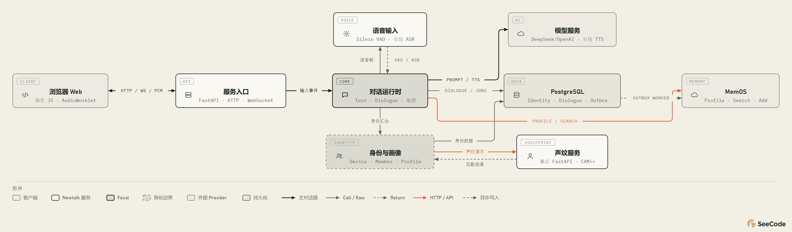

# Newtalk

面向家庭陪伴场景的实时语音对话系统。参考小智服务端的实时语音思路，以独立 Python 工程实现浏览器对话、声纹身份、短期上下文和长期记忆。



## 能力与技术栈

- 文字和实时语音共用对话链路，支持语音打断、刷新恢复和新对话清理。
- 设备级家庭空间、成员管理、三段声纹录入与自动匹配。
- 成员 Profile、MemOS 按需检索、后台记忆写入和 Memory Center 人工管理。
- 首页、对话、家庭成员和记忆中心独立切换；另有上下文调试看板、逐轮时延和音频诊断。

后端使用 Python 3.11、FastAPI、WebSocket、asyncio；持久化使用 PostgreSQL、SQLAlchemy async 和 Alembic。前端为原生 HTML/CSS/JavaScript + AudioWorklet。外部能力包括豆包 ASR/TTS、OpenAI-compatible LLM、CAM++ 声纹和 MemOS。

## 本地启动

以下命令适用于已经安装依赖的本机环境。首次准备主环境：`py -3.11 -m venv .venv`，然后用 `.venv\Scripts\python -m pip install -e ".[dev]"` 安装主项目。将 `.env.example` 复制为 `.env`，按需填写数据库和 Provider 配置，切勿提交密钥。

**数据库二选一**：已有本机 PostgreSQL 时直接使用；没有时运行 `docker compose up -d postgres`。Compose 默认占用 `5432`，不要和本机数据库同时争用该端口；切换数据库也会切换所见的数据。

```powershell
cd D:\Desktop\Newtalk
.\.venv\Scripts\Activate.ps1
alembic upgrade head
newtalk
```

打开 [Newtalk](http://127.0.0.1:8006/)，服务状态见 [主服务 Health](http://127.0.0.1:8006/health)。不要直接用文件路径打开 `web/index.html`。

真实声纹需要另一个进程，在装有声纹依赖的环境中启动：

```powershell
cd D:\Desktop\Newtalk
.\.venv\Scripts\Activate.ps1
$env:VOICEPRINT_BACKEND = "campplus"
newtalk-voiceprint
```

首次安装声纹依赖可在独立虚拟环境执行 `python -m pip install -e ".\services\voiceprint[campplus]"`，并改为激活该环境启动。检查 [VoicePrint Health](http://127.0.0.1:8010/health)：真实模型应显示 `backend=campplus`；`deterministic` 仅供测试。接口说明见 [VoicePrint Docs](http://127.0.0.1:8010/docs)。

声纹服务读取项目 `.env`；`VOICEPRINT_API_TOKEN` / `VOICEPRINT_DATABASE_URL` 优先，未设置时分别复用 `NEWTALK_VOICEPRINT_API_TOKEN` / `NEWTALK_DATABASE_URL`。主服务与声纹服务必须使用匹配的 Token 和同一个数据库。同一端口只启动一个实例。

## 测试与日志

```powershell
.\.venv\Scripts\python -m pytest tests services/voiceprint/tests -q
```

真实数据库和 Provider 测试需要额外环境，未配置时会跳过；真实 Provider 调用可能产生费用。CI / PR 流程见 [开发流程](docs/DEVELOPMENT_WORKFLOW.md)。

日志默认输出到终端；需要留档时，用以下命令代替 `newtalk` 启动：

```powershell
New-Item -ItemType Directory -Force .\logs | Out-Null
newtalk 2>&1 | Tee-Object -FilePath .\logs\newtalk.log
```

排查麦克风或声纹时：先在“对话”连接并开启麦克风，再展开“语音诊断”，点击“保存接下来 10 秒”，自然说话后结束保存，即可试听或下载 WAV。仅旁路复制实际发送的 16kHz 单声道 PCM，不改变聊天输入；不是服务端 VAD 裁切后的单句声纹样本。录音仅保留在当前页面内存，刷新、清除或成员列表变化时释放，不额外上传；试听会关闭聊天麦克风并停止助手播放，继续聊天需再次开启麦克风。过去的录音无法补取；下载文件需自行删除。

录音诊断的前端测试：`node --test tests/frontend/test_audio_diagnostics.mjs`。

用 `session_id` / `turn_id` / `utterance_id` 关联事件。关注 `asr_final`、`speaker_resolved`、`llm_first_token`、`tts_first_audio`、`browser_playback_started`、`browser_playback_drained` 的 `elapsed_ms`；不同事件的计时起点可能不同，不要直接相减当作整轮耗时。浏览器逐轮时延只供当前页面诊断，不随历史对话恢复。

需要检查“本轮模型到底看到了什么”时，在 `.env` 设置 `NEWTALK_CONTEXT_DEBUG=true` 并重启主服务。也可只对当前终端启用：

```powershell
$env:NEWTALK_CONTEXT_DEBUG = "true"
newtalk
```

完成一次对话后查看 `logs/context-debug.jsonl`，按 `turn_id` 筛选：

```powershell
Get-Content .\logs\context-debug.jsonl -Encoding UTF8 |
    ForEach-Object { $_ | ConvertFrom-Json } |
    Where-Object { $_.turn_id -eq "替换为本轮 turn_id" } |
    ConvertTo-Json -Depth 30
```

关键事件为 `context_selected`（身份、画像及历史取舍）、`llm_request`（最终请求，含两次工具轮）、`memory_search_usage` / `memory_search_result`、`turn_end`（回复与提交结果）。`unknown` 表示操作途中被取消，无法确定是否落库，不能当作失败。完整边界见 [上下文调试](docs/architecture.md#上下文调试与回复规则)。

也可打开侧栏“上下文看板”（[本机入口](http://127.0.0.1:8006/#context)），或点击聊天回复上的“查看上下文”。左侧选择/筛选轮次，右侧展开身份、历史取舍、检索结果、每次真实请求和提交结果；看板可自动刷新，但只展示事实，不生成模型思维链或质量分数。

调试默认关闭。开启后，完整正文写独立本机文件，并可由当前设备鉴权后在看板读取；看板只保留当前进程最多 30 分钟、500 条事件、约 200 万字符的缓存，不回放旧日志。文件按 5 MiB 轮转，保留两个备份。记录包含私人对话、画像和记忆，诊断后关闭开关并清理；普通 `DEBUG` 日志级别不会自动开启此能力。终端环境变量优先于 `.env`，用 `Remove-Item Env:NEWTALK_CONTEXT_DEBUG` 撤销终端覆盖。

## 文档索引

- [架构与已知边界](docs/architecture.md)：模块、Task 归属、设计决策和当前限制的唯一说明。
- [接口协议](docs/protocol.md)：浏览器 HTTP / WebSocket 与内部声纹接口契约。
- [后续路线图](docs/roadmap.md)：未完成事项及验收标准，不复述已交付阶段。
- [开发流程](docs/DEVELOPMENT_WORKFLOW.md)：本地验证、提交、PR 和 CI。
- [AI 协作规则](AGENTS.md)：修改范围、测试和文档维护约束。
- 审查快照：[2026-10-22](docs/audits/2026-10-22-code-audit.md)、[2026-10-20](docs/audits/2026-10-20-code-review.md)。历史结论不等于当前待办。

架构图源文件为 [JSON](diagrams/newtalk-current-architecture.json)。使用已安装的 SeeCode，通过 `node <技能目录>/scripts/seecode.mjs render <JSON 路径>` 和 `node <技能目录>/scripts/seecode.mjs export <生成的 HTML 路径> --formats png --for readme` 重建交互图和图片；HTML 是可再生产物，不作为常驻文档维护。
